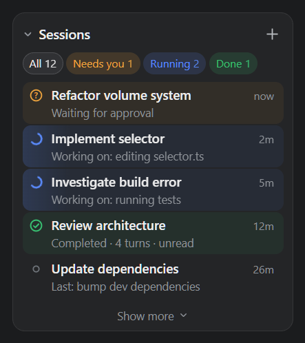

# dsh-session-dashboard

DeepSeek Harness Web GUI 插件：在**左侧边栏常驻一张会话状态卡片**（位于 Settings 上方），不用点开页面就能随时看到最近会话在做什么。

[English](README.md) | 中文

## 功能

- 左侧边栏常驻会话卡片；侧栏收起为 56px 轨道时变成一个图标按钮，有「需要你」时显示数字角标
- 每个会话一行：状态图标、标题、当前动作（等待审批 / 正在执行 / 已完成未查看 / 空闲）和相对时间
- 筛选 All / Needs you / Running / Done，带实时计数；切换筛选时卡片高度保持不变
- 点击任意行进入该会话；`+` 新建会话
- 默认展示 5 行，可展开到 10 行
- 设置 → Sessions card 侧栏页：卡片语言（English / 中文）与默认条目数
- 需要你、运行中、完成未查看的会话优先展示；运行中的行带扫光动效



> 图中会话标题为示例数据。

已在 DSH `0.2.1-rc.2`（Web profile）与 `0.2.1-rc.3`（Desktop profile）验证：官方 `dsh plugin` 安装成功、`--dump-config` 出现 `# == dsh-session-dashboard` 层、client-modules 正常下发 bundle、卡片位置/筛选/跳转/新建/收起态角标均可用，控制台无插件报错。

## 官方插件形态

这是一个标准的 DSH **bundle**（组合包），不是宿主的私有扩展：

| 官方要求 | 本包 |
|---|---|
| `dsh.bundle.patch` 指向配置层 | `./cordis.patch.yml`，把本包按包名插入 Loader |
| `dsh.client.platform: "web"` + `exports["./client"]` | 指向 `client/client.js`（预构建的 `__ModuleLoader__` 工厂） |
| `engines.dsh` 兼容范围 | `>=0.2.0 <0.3.0`（0.2.1-rc.2 / rc.3 均通过） |
| 安装到 profile 的 `bundles` 列表 | `dsh plugin add` 自动追加 |
| 分发预构建产物，安装期无需构建 | 纯 JS，无 `prepare`/build 脚本，git/tarball/npm 安装都不需要构建授权 |
| `license`、`icon`、`files` | MIT、`icon.svg`、发布文件清单齐全 |

官方文档：[打包与安装插件](https://deepseek-harness.github.io/deepseek-harness/develop/basic/publish.md)。

## 安装

插件是纯前端（浏览器侧）插件，没有 Host 服务、没有配置项、没有后台任务；安装/卸载全部走官方 `dsh plugin`（pnpm + profile manifest），不需要手工改 profile 或 node_modules。

### 1. 打包发布产物

在插件目录中执行：

```powershell
pnpm pack --pack-destination <输出目录>
# 产出 dsh-session-dashboard-<version>.tgz
```

### 2. Desktop profile

`desktop` profile 由 Electron 应用拥有，npm 全局 CLI 会拒绝管理它；改用桌面端自带的命令运行时：

```powershell
$dsh = "<DeepSeek Harness 安装目录>\resources\runtime\cli\bin\dsh.cmd"
& $dsh plugin --profile desktop add <输出目录>\dsh-session-dashboard-<version>.tgz
& $dsh plugin --profile desktop --dump-config   # 可选：确认出现 "# == dsh-session-dashboard"
```

安装会写入 profile 的 `dependencies`（`file:...tgz`）和 `dsh.profile.bundles`，由 pnpm 落盘到 `node_modules`。**tarball 必须保留**：profile dependency 指向它，移动或删除后需要重新 `add`。

升级：提升 `version` → 重新 `pnpm pack` → 用新 tarball 再 `add` 一次。卸载：

```powershell
& $dsh plugin --profile desktop remove dsh-session-dashboard
```

重载桌面窗口（`Ctrl+R`）或重启应用；live patch reload 生效时刷新页面即可。

### 3. Web profile

```powershell
dsh plugin --profile web add <插件目录>
dsh --profile web --dump-config
dsh plugin --profile web remove dsh-session-dashboard
```

`dsh plugin` 会把本地包解析为 pnpm `link:` 依赖并自动追加 bundle；重启 `dsh web`（或刷新页面）生效。

## 数据来源

不自行请求 Host，也不保存任何会话状态。卡片是 root-scoped 侧栏 footer seat 的占位者，直接使用 slot 系统给所有 root 槽的标准 seat：

| seat / 数据 | 用途 |
|---|---|
| `useSessions` | 会话目录、`displayTitle`、`updatedAt`、`blank`/`origin`、`projectionsBySession` |
| `useSessionStatus` | `running`、`pendingInteraction`（`approval` / `plan-review` / `question`）、`completionUnread` |
| `useWorkspaces` | `archivedSessionIds`（默认隐藏归档会话） |
| `projectionsBySession[*].values` | `todos`（当前进行中的 todo）、`turnOutline`（本轮指令与轮数）、`sessionStats` |

打开会话走 `ctx.uiWorkspace.openSession(id)`，新建走 `ctx.uiWorkspace.startSession()`，收起态点击图标走 `ctx.layout.toggleSidebar()`。

## 结构

```
package.json          # dsh.bundle.patch + dsh.client（platform: web）+ engines.dsh
cordis.patch.yml      # 把本包作为 Loader entry 插入 profile
lib/index.js          # Host 侧空插件（只为让 Loader 持有 fiber，client-modules 才会发现浏览器半）
client/client.js      # 整个 UI：__ModuleLoader__ 工厂 + React 卡片 + 主题化 CSS
icon.svg              # 插件管理器展示图标
LICENSE               # MIT
docs/sidebar-card.png    # 效果截图（示例数据）
docs/limitations.zh.md # 已知边界（中文）
 docs/limitations.md    # 已知边界（英文）
```

`client/client.js` 是手写的 CJS-in-loader 工厂（`window.__ModuleLoader__.load({ id, factory })`），**不需要构建**：改完直接刷新页面。唯一运行时依赖是平台基线里的 `react`；样式使用宿主主题变量 `--dsw-alias-*`，亮/暗主题自动适配。

已知边界见 [docs/limitations.zh.md](docs/limitations.zh.md)。
